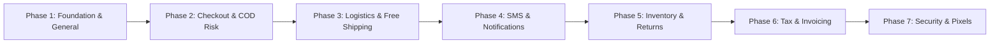

# VibeLock Admin Settings Engine — Master Architecture & Implementation Plan

> **Document Version:** 1.0.0  
> **Target System:** VibeLock E-Commerce Platform (Next.js 16 App Router, TypeScript, Prisma, Neon PostgreSQL)  
> **Status:** Proposed / Pending Architecture Sign-Off  
> **Author:** Antigravity AI & VibeLock Core Engineering

---

## 1. Executive Summary & Vision

Currently, VibeLock's administrative configuration is heavily bifurcated: payment channels are partially controlled via `/admin/settings/payments`, while crucial operational variables—such as store contact information, WhatsApp numbers, currency, SMS gateway secrets, return windows, low-stock thresholds, and free-shipping triggers—are hardcoded in static TypeScript constants (`src/lib/config/app.ts`) or `.env` configuration files.

### 1.1 The Problem Statement

In a fast-growing streetwear brand in Bangladesh:

1. **Developer Bottleneck:** Every business pivot (e.g. changing support hours, updating WhatsApp numbers, enabling Eid vacation announcements) requires a code commit and production deployment.
2. **Margin Bleed via COD Fraud:** Without fine-grained checkout governance (advance delivery fee rules, max COD thresholds), fake orders result in massive courier return expenses (৳120–৳150 per failed delivery).
3. **Audit & Compliance Risk:** Changes to store policies and financial configurations are not tracked in an immutable audit ledger.

### 1.2 The Architectural Goal

Transform the `/admin/settings` module into an **Enterprise-Grade Store Operating System**:

- **Zero-Code Operation:** Business owners can configure policies, thresholds, and integrations in real time without developer intervention.
- **Polymorphic Database Storage:** A single, strongly-typed `StoreSetting` database model stores all setting categories without requiring repeated database migrations.
- **Resilient Fallback (Strategy A):** If the database is unreachable or table migrations are unapplied, the system gracefully falls back to verified static defaults (`appConfig` and `.env`) without runtime exceptions.
- **Immutable Audit Logging:** Every setting mutation is recorded inside a Prisma `$transaction` targeting the `AuditLog` table with actor attribution and state diffs.

---

## 2. Core Architecture & Database Design

### 2.1 The Polymorphic `StoreSetting` Model

Instead of creating dozens of disparate tables or wide tables with 50+ columns, we utilize a polymorphic JSON model validated by Zod schemas in the application service layer:

```prisma
model StoreSetting {
  id          String   @id @default(uuid())
  key         String   @unique // e.g., "GENERAL_STORE_SETTINGS", "CHECKOUT_COD_POLICY"
  value       Json     // Validated against group-specific Zod schemas
  description String?  // Human-readable operational description
  updatedBy   String?  // User ID of the admin who performed the update
  createdAt   DateTime @default(now())
  updatedAt   DateTime @updatedAt

  @@index([key])
}
```

```
┌─────────────────────────────────────────────────────────────┐
│                       Admin Browser                         │
│             /admin/settings/[general | checkout | ...]       │
└──────────────────────────────┬──────────────────────────────┘
                               │ Form Submission (Server Action)
                               ▼
┌─────────────────────────────────────────────────────────────┐
│                 Zod Validation & Guardrail                  │
│       Ensure constraints (e.g., Min < Max, valid phone)      │
└──────────────────────────────┬──────────────────────────────┘
                               │ Atomic Prisma Transaction
                               ▼
┌──────────────────────────────┴──────────────────────────────┐
│                    Neon PostgreSQL Store                    │
│   ├── StoreSetting (Upsert key-value payload)               │
│   └── AuditLog (Record actorId, previousState, newState)   │
└──────────────────────────────┬──────────────────────────────┘
                               │ Fallback Pipeline (Strategy A)
                               ▼
┌─────────────────────────────────────────────────────────────┐
│                 Graceful Degraded Runtime                   │
│   If DB is missing table: fallback to env / app.ts defaults │
└──────────────────────────────┘
```

---

## 3. The 7 Implementation Phases



---

### Phase 1: Foundation & General Store Settings (`/admin/settings/general`)

#### Objective

Establish the `StoreSetting` database engine, service abstraction layer, and the core store identity configuration.

#### Key Features

1. **Store Identity:** Legal business name, public brand name, DBID (Digital Business Identification) number, Trade License / BIN.
2. **Omnichannel Contact:** Customer service hotline, official WhatsApp digits, support email, physical warehouse/studio address.
3. **Operational Killswitches:**
   - **Maintenance Mode:** Disables customer checkout with a customizable announcement banner. Includes an admin bypass token.
   - **Vacation / Eid Mode:** Keeps checkout open but displays a prominent notice (e.g. _"Orders placed between 10–15 April will ship on 16 April"_).
4. **Localization:** Store default currency (BDT), timezone (`Asia/Dhaka`), locale (`en-BD` / `bn-BD`).

#### TypeScript Contract (`GeneralSettingsSchema`)

```typescript
export interface GeneralStoreSettings {
  storeName: string;
  legalBusinessName: string;
  dbidNumber?: string;
  tradeLicenseNumber?: string;
  supportPhone: string;
  whatsappNumber: string;
  supportEmail: string;
  warehouseAddress: string;
  maintenanceMode: {
    enabled: boolean;
    noticeTitle: string;
    noticeMessage: string;
    allowAdminBypass: boolean;
  };
  holidayMode: {
    enabled: boolean;
    bannerText: string;
    expectedDispatchDate?: string;
  };
}
```

---

### Phase 2: Checkout & COD Risk Governance (`/admin/settings/checkout`)

#### Objective

Eliminate cash bleed from fake or uncollected Cash on Delivery (COD) consignments and regulate inventory reservation timeouts.

#### Key Features

1. **Partial Advance Delivery Charge Rule:**
   - Require customers to pay the courier fee (e.g. ৳100 inside Dhaka, ৳150 outside Dhaka) via bKash/PayStation upfront to confirm high-value COD orders.
2. **Maximum COD Order Value Ceiling:**
   - Orders exceeding a configured threshold (e.g. ৳8,000) automatically disable COD, requiring digital payment.
3. **Unpaid Online Order Reservation TTL:**
   - Configure how long inventory is reserved when a customer enters an online gateway session (e.g. 15 vs 30 minutes) before releasing stock back to the public.
4. **Minimum Order Value:**
   - Prevent micro-orders below a minimum threshold (e.g. ৳300).
5. **First-Time Buyer Verification:**
   - Require SMS OTP verification for customers with zero prior successful deliveries.

#### TypeScript Contract (`CheckoutSettingsSchema`)

```typescript
export interface CheckoutSettings {
  minOrderValue: number;
  maxCodOrderValue: number;
  requireCodAdvanceDeliveryCharge: boolean;
  codAdvanceInsideDhaka: number;
  codAdvanceOutsideDhaka: number;
  onlineReservationTtlMinutes: number;
  enforceFirstTimeCodOtp: boolean;
  allowGuestCheckout: boolean;
}
```

---

### Phase 3: Logistics, Shipping & Free Delivery Thresholds (`/admin/settings/shipping-rules`)

#### Objective

Centralize nationwide delivery economics and courier fulfillment defaults.

#### Key Features

1. **Free Shipping Incentive Engine:**
   - Global threshold (e.g. _"Free delivery on orders above ৳2,500"_).
   - Zone exclusions (e.g. Free shipping applies only inside Dhaka or nationwide).
2. **Default Pickup Hub & Warehouse:**
   - Address, contact person, and phone number transmitted in Steadfast / Pathao courier dispatch APIs.
3. **Estimated Delivery Promises:**
   - Configurable delivery SLA strings displayed at checkout:
     - Inside Dhaka: _"24–48 Hours"_
     - Outside Dhaka: _"3–5 Business Days"_

---

### Phase 4: Omnichannel SMS & Notifications Engine (`/admin/settings/notifications`)

#### Objective

Automate customer SMS lifecycle tracking and internal operational alerts.

#### Key Features

1. **SMS Gateway Credentials & Provider Selection:**
   - UI configuration for BulkSMSBD, Greenweb, ReveSMS, or custom HTTP endpoint.
2. **Transactional Event Switches:**
   - `[x]` Order Placed Confirmation SMS
   - `[x]` Order Dispatched with Courier Tracking Link SMS
   - `[x]` Out for Delivery Real-Time SMS
   - `[x]` Return / Refund Approved SMS
3. **Store Admin Operational Alerts:**
   - Send Telegram or SMS alert to store managers when:
     - An order over ৳15,000 is placed.
     - SMS gateway account balance falls below 100 SMS credits.

---

### Phase 5: Inventory Intelligence & Return Policies (`/admin/settings/inventory-returns`)

#### Objective

Protect product margins and automate inventory threshold triggers.

#### Key Features

1. **Global Low-Stock Alert Threshold:**
   - Trigger visual dashboard warning when variant inventory falls below $N$ units (default: 3).
2. **Out-of-Stock Display Behavior:**
   - Toggle between _"Display as Sold Out"_, _"Hide from Catalog"_, or _"Allow Pre-Order / Backorder"_.
3. **Customer Return Window:**
   - Days allowed for returns post-delivery timestamp (e.g. 3 days vs 7 days).
4. **Courier Cost Allocation on Return:**
   - Option to automatically deduct reverse courier charge (৳130) from customer refund.
5. **Non-Returnable Tagging:**
   - Categories ineligible for return (Clearance, Innerwear, Socks, Accessories).

---

### Phase 6: Tax, VAT & Invoicing Compliance (`/admin/settings/tax-invoice`)

#### Objective

Ensure legal compliance with National Board of Revenue (NBR) digital commerce guidelines.

#### Key Features

1. **NBR Mushak-6.3 VAT Engine:**
   - Configurable VAT percentage (e.g. 5%, 7.5%, 15%).
   - Price calculation mode: **Inclusive** (VAT built into product price) vs **Exclusive** (VAT added at checkout).
2. **Custom Invoice Prefixing:**
   - Formatter: `[PREFIX]-[YEAR]-[ORDER_NUMBER]` (e.g. `VL-2026-00482`).
3. **Packaging Slip Footer & Return Notice:**
   - Customizable printed return instructions and company seal.

---

### Phase 7: Analytics, Tracking Pixels & Admin Security (`/admin/settings/security`)

#### Objective

Streamline marketing tracking and internal system security.

#### Key Features

1. **Marketing Tracking Integration:**
   - Meta (Facebook) Pixel ID and Conversions API (CAPI) Server Access Token.
   - Google Tag Manager (GTM) Container ID.
   - TikTok Pixel ID.
2. **Admin Security Governance:**
   - Inactivity auto-logout timer (15 min, 30 min, 1 hour).
   - Audit Log retention policy (auto-archive records older than 180 days).

---

## 4. Implementation Matrix & File Manifest

| Phase       | Files to Create / Modify                                                                                                                                                                                                                   | Scope Description                                                                      |
| :---------- | :----------------------------------------------------------------------------------------------------------------------------------------------------------------------------------------------------------------------------------------- | :------------------------------------------------------------------------------------- |
| **Phase 1** | `prisma/schema.prisma`<br>`src/lib/settings/store-settings-service.ts`<br>`src/lib/admin/settings/general-settings-actions.ts`<br>`src/app/(protected)/admin/settings/layout.tsx`<br>`src/app/(protected)/admin/settings/general/page.tsx` | `StoreSetting` database model, service layer, general settings form, tabs integration. |
| **Phase 2** | `src/lib/settings/checkout-settings.ts`<br>`src/lib/admin/settings/checkout-settings-actions.ts`<br>`src/app/(protected)/admin/settings/checkout/page.tsx`<br>`src/lib/checkout/order-creation.ts`                                         | COD advance charges, max order limit, TTL reservation guardrails.                      |
| **Phase 3** | `src/app/(protected)/admin/settings/shipping/page.tsx`<br>`src/lib/admin/shipping/shipping-rules-actions.ts`<br>`src/lib/checkout/shipping-calculator.ts`                                                                                  | Free shipping threshold, warehouse hub defaults.                                       |
| **Phase 4** | `src/app/(protected)/admin/settings/notifications/page.tsx`<br>`src/lib/sms/client.ts`<br>`src/lib/admin/settings/notification-actions.ts`                                                                                                 | Dynamic SMS provider switcher, event toggles.                                          |
| **Phase 5** | `src/app/(protected)/admin/settings/policies/page.tsx`<br>`src/lib/returns/validation.ts`                                                                                                                                                  | Return window verification, low-stock threshold triggers.                              |
| **Phase 6** | `src/app/(protected)/admin/settings/invoicing/page.tsx`<br>`src/lib/invoices/generator.ts`                                                                                                                                                 | NBR Mushak-6.3 VAT engine, invoice prefixing.                                          |
| **Phase 7** | `src/app/(protected)/admin/settings/security/page.tsx`<br>`src/components/analytics/pixel-loader.tsx`                                                                                                                                      | Pixel/CAPI tokens, session timeout controls.                                           |

---

## 5. Verification & Rollout Safeguards

1. **Test-Driven Foundation:** Every phase will include dedicated integration tests in `tests/integration/` verifying:
   - Admin authorization guards (`ADMIN` role strictly enforced).
   - Strategy A fallback resilience (returns safe defaults when table is missing or DB errors).
   - Atomic audit logging verification (`AuditLog` record created on update).
   - Zero-client-trust credential validation.
2. **Non-Breaking Deployment:** Since `StoreSetting` uses polymorphic key-value pairs, subsequent phases (Phase 2 through 7) will require **zero new schema migrations**, preventing production downtime.
3. **Lint & Type Safety:** 100% adherence to `npm run typecheck` and `npm run lint` with strict TypeScript types for all settings schemas.

---

## 6. Next Steps & Approval Gate

To initiate **Phase 1**, we require user approval to add the `StoreSetting` model to `prisma/schema.prisma` and execute the baseline migration.
