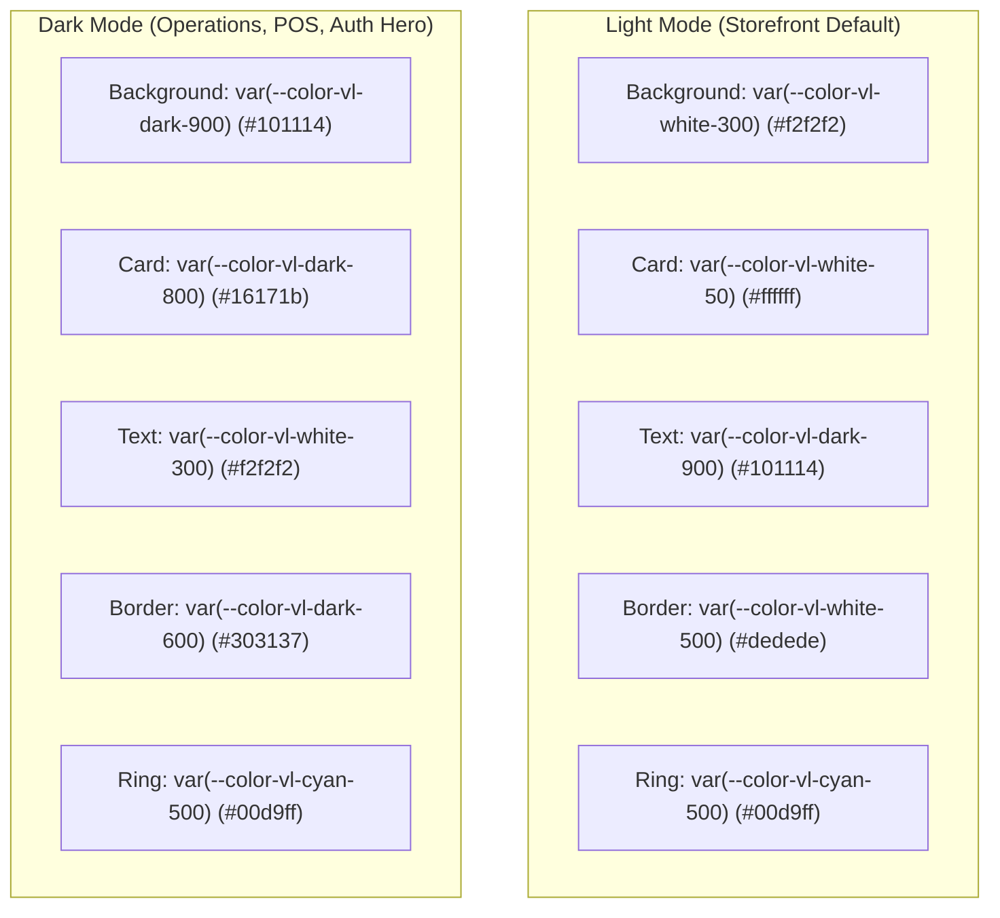

# VibeLock Color System Guide for AI Agents & Developers

> **Status:** Active & Canonical  
> **Source of Truth:** [`src/app/globals.css`](file:///e:/All%20Project/POS-System/vibelock-web/src/app/globals.css)  
> **Framework:** Next.js App Router (Turbopack) with Tailwind CSS v4 (`@theme inline`)

---

## 1. Executive Summary & Design Philosophy

VibeLock is an elevated, confident, and minimalist Bangladeshi streetwear brand. The visual identity relies on **high contrast, technical precision, and brutalist streetwear restraint**.

The entire project is structured around **3 Core Color Scales** (10 steps each, `50` to `900`):

| Color Scale | Canonical Hex | Role | Primary Usage |
| :--- | :---: | :--- | :--- |
| **`vl-cyan`** | `#00d9ff` | Core Brand Accent & Cyber Glow | CTA buttons, active badges, focus rings, cyber glows, highlights |
| **`vl-dark`** | `#101114` | Obsidian Charcoal Black | Headings, buttons, dark cards, POS terminal, admin operations |
| **`vl-white`** | `#f2f2f2` | Clean White Canvas | Storefront light canvas, card surfaces, light borders, subtle dividers |

---

## 2. Complete 10-Step Color Palettes (Tailwind Utilities)

All tokens are defined in Tailwind CSS v4 via `@theme inline`. You can use them directly in class names: `bg-vl-cyan-500`, `text-vl-dark-900`, `border-vl-white-500`, `bg-vl-cyan/20`, etc.

### A. `vl-cyan` — Electric Cyber Cyan
*Anchored at `500` to `#00d9ff`.*

| Token | Hex Value | Usage / Role |
| :--- | :---: | :--- |
| `vl-cyan-50` | `#f0fdff` | Ultra-subtle cyan tint / notification highlight background |
| `vl-cyan-100` | `#dcf8ff` | Subtle badge background / light mode pill background |
| `vl-cyan-200` | `#b3f2ff` | Soft highlight / secondary cyan chip |
| `vl-cyan-300` | `#70e7ff` | Decorative graphics / cyan icons on dark surfaces |
| `vl-cyan-400` | `#2ae0ff` | **Hover state** for cyan buttons / active glow highlight |
| `vl-cyan-500` | **`#00d9ff`** | **Canonical Brand Accent** — Primary focus rings, CTAs, hero badges |
| `vl-cyan-600` | `#00b8db` | Solid button active/pressed state |
| `vl-cyan-700` | `#0088a8` | High-contrast dark-mode cyan text (passes WCAG on dark) |
| `vl-cyan-800` | `#006780` | Deep cyan border / container outline |
| `vl-cyan-900` | `#004859` | Dark cyan container surface / tinted backdrop |
| `vl-cyan` | *(alias)* | Aliased directly to `vl-cyan-500` (`#00d9ff`) |

---

### B. `vl-dark` — Obsidian Charcoal Black
*Anchored at `900` to `#101114`.*

| Token | Hex Value | Usage / Role |
| :--- | :---: | :--- |
| `vl-dark-50` | `#f6f7f9` | Ultra-light cool grey / subtle surface |
| `vl-dark-100` | `#eceef2` | Cool grey divider / light neutral chip |
| `vl-dark-200` | `#d5d8e0` | Light border / secondary line |
| `vl-dark-300` | `#a9b0c0` | Disabled text / muted line |
| `vl-dark-400` | `#777982` | **Subtitle & Neutral Grey** (formerly `vl-grey`) |
| `vl-dark-500` | `#545763` | Muted body text on dark mode / metadata text |
| `vl-dark-600` | `#303137` | **Dark Mode Container Border** (formerly `border-dark`) |
| `vl-dark-700` | `#212228` | **Dark Mode Secondary** / Table row hover |
| `vl-dark-800` | `#16171b` | **Dark Mode Card & Modal Surface** (formerly `surface-dark`) |
| `vl-dark-900` | **`#101114`** | **Canonical Obsidian Black** — Headings, buttons, dark mode body |
| `vl-dark` / `vl-black` | *(alias)* | Aliased directly to `vl-dark-900` (`#101114`) |

---

### C. `vl-white` — Clean White Canvas
*Anchored at `300` to `#f2f2f2`.*

| Token | Hex Value | Usage / Role |
| :--- | :---: | :--- |
| `vl-white-50` | `#ffffff` | **Pure Clean White** — Cards, popovers, elevated surfaces |
| `vl-white-100` | `#fafafa` | Ultra-soft light surface / secondary card tint |
| `vl-white-200` | `#f7f7f7` | Table header background / light chip surface |
| `vl-white-300` | **`#f2f2f2`** | **Canonical White Canvas** — Default light mode background |
| `vl-white-400` | `#e8e8e8` | Secondary light surface / subtle divider / muted light bg |
| `vl-white-500` | `#dedede` | **Light Mode Border** — Default container / card border |
| `vl-white-600` | `#c4c4c4` | Product card border / table borders |
| `vl-white-700` | `#9e9e9e` | Secondary light-mode icon color |
| `vl-white-800` | `#6e6e6e` | WCAG AA compliant muted text on light mode |
| `vl-white-900` | `#333333` | High-contrast dark text on light mode |
| `vl-white` | *(alias)* | Aliased directly to `vl-white-300` (`#f2f2f2`) |

---

## 3. Semantic & Operational Statuses

Do NOT invent new status colors. Always use these standardized tokens:

| Token | Hex Value | Meaning |
| :--- | :---: | :--- |
| `status-sale` / `destructive` | `#e50010` / `oklch(...)` | Streetwear discount badge, stockout alert, destructive modal action |
| `status-success` | `#10b981` | Order confirmed, payment successful, in-stock indicator |
| `status-warning` | `#f59e0b` | Payment pending, low stock alert, return requested |
| `status-error` | `#ef4444` | Form validation error, payment failed, connection error |
| `status-info` | `#00d9ff` | Tracking update, informational notice (uses `vl-cyan`) |

### Bangladesh Payment Gateways:
- `gateway-sslcommerz`: `#2563eb` (SSLCOMMERZ Blue)
- `gateway-bkash`: `#e2136e` (bKash MFS Pink)
- `gateway-nagad`: `#f7941d` (Nagad MFS Amber)
- `gateway-cod`: `#059669` (Cash on Delivery Emerald)

---

## 4. Theme Modes: Light vs Dark Architecture

VibeLock uses a strict dual-mode architecture:

---

## 5. Mandatory Rules for AI Agents

When modifying existing code or creating new features, follow these rules strictly:

### 🛑 RULE 1: Never Use Arbitrary Hex Codes
- ❌ **Forbidden:** `text-[#00D9FF]`, `bg-[#101114]`, `border-[#303137]`, `bg-[#f2f2f2]`, `bg-[#F3F0E8]`
- ✅ **Required:** `text-vl-cyan`, `bg-vl-dark-900`, `border-vl-dark-600`, `bg-vl-white-300`, `bg-vl-white`

### 🛑 RULE 2: Never Add Ad-Hoc Gray Scales
- ❌ **Forbidden:** Adding arbitrary Tailwind colors like `zinc-800`, `slate-900`, `neutral-700` for core elements.
- ✅ **Required:** Use `vl-dark-*` for darks and `vl-white-*` for light surfaces to maintain visual harmony.

### 🛑 RULE 3: Use UI Primitives First
- ❌ **Forbidden:** Creating raw `<input>`, `<button>`, `<select>`, `<textarea>` or manual card containers with raw borders.
- ✅ **Required:** Import from `@/components/ui/` (`Button`, `Input`, `Textarea`, `Card`, `Dialog`, `Table`, `Select`, `Badge`).
- **Button Variants:**
  - `variant="primary"`: Obsidian black background (`bg-vl-black`), white text, subtle cyan glow hover.
  - `variant="brand"`: Electric cyan background (`bg-vl-cyan`), obsidian dark text (`text-vl-dark-900`), cyan glow hover.
  - `variant="secondary"`, `variant="outline"`, `variant="ghost"`, `variant="destructive"`, `variant="danger"`, `variant="link"`.
- **Badge Component:** Full visual catalog, status dots, e-commerce drops & lifecycle rules are documented in [`docs/BADGE_USAGE_GUIDE.md`](./BADGE_USAGE_GUIDE.md).

### 🛑 RULE 4: Translucent States Use Tailwind Slash Syntax
- ❌ **Forbidden:** `rgba(0, 217, 255, 0.2)` in inline styles or bracket classes.
- ✅ **Required:** `bg-vl-cyan/20`, `border-vl-dark-900/10`, `border-vl-cyan/40`.

### 🛑 RULE 5: Focus States Must Always Use Cyan
- Every interactive form control or button must use:
  `focus-visible:ring-2 focus-visible:ring-vl-cyan focus-visible:outline-none`

---

## 6. Cheat Sheet: Legacy-to-Design System Conversion

Use this table when updating older components:

| Old / Arbitrary Code | Replace With |
| :--- | :--- |
| `text-[#00D9FF]`, `text-[#00d9ff]` | `text-vl-cyan` (or `text-vl-cyan-500`) |
| `bg-[#00D9FF]`, `bg-[#00d9ff]` | `bg-vl-cyan` (or `bg-vl-cyan-500`) |
| `border-[#00D9FF]/40` | `border-vl-cyan/40` |
| `bg-[#101114]`, `bg-[#101114]/80` | `bg-vl-dark-900`, `bg-vl-dark-900/80` (or `bg-vl-black`) |
| `text-[#101114]` | `text-vl-dark-900` (or `text-vl-black`) |
| `border-[#101114]/10` | `border-vl-dark-900/10` |
| `bg-[#F3F0E8]`, `bg-[#f2f2f2]` | `bg-vl-white-300` (or `bg-vl-white`) |
| `text-[#F3F0E8]`, `text-[#f2f2f2]` | `text-vl-white-300` (or `text-vl-white`) |
| `border-[#303137]` | `border-vl-dark-600` |
| `bg-[#16171b]` | `bg-vl-dark-800` |
| `bg-[#212228]` | `bg-vl-dark-700` |
| `text-[#777982]` | `text-vl-dark-400` (or `text-vl-grey`) |
| `border-[#dedede]` | `border-vl-white-500` |
| `bg-[#fafafa]` | `bg-vl-white-100` |
| `bg-[#ffffff]` | `bg-vl-white-50` (or `bg-white`) |

