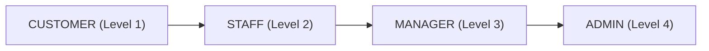
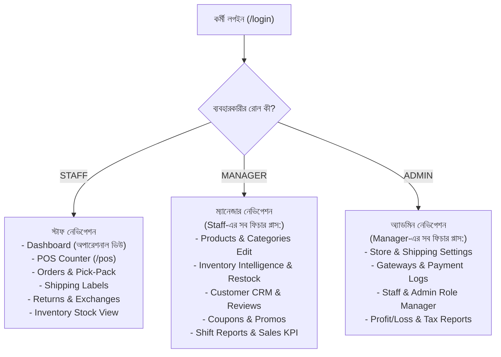

# VibeLock — Unified Role-Based Operations Dashboard Plan (RBAC)

> **লক্ষ্য:** আলাদা আলাদা ড্যাশবোর্ড তৈরি করার কোড ডুপ্লিকেশন পরিহার করে একক `/admin` ড্যাশবোর্ডে রোল-ভিত্তিক নিরাপত্তা ও ডায়নামিক নেভিগেশন (Staff, Manager, Admin) বাস্তবায়ন করা।

---

## ১. বর্তমান অবস্থা ও স্থাপত্য বিশ্লেষণ (Current State)

বর্তমানে সিস্টেমে ৪টি রোল রয়েছে:


- **বর্তমান সমস্যা:**
  - `src/app/(protected)/admin/layout.tsx` শুধুমাত্র `ADMIN` রোল অনুমোদন করে (`requireRole("ADMIN")`)। ফলে `STAFF` বা `MANAGER` লগইন করলেও তারা অ্যাক্সেস পায় না।
  - `src/app/(protected)/staff` এবং `src/app/(protected)/manager` ডিরেক্টরিগুলো সম্পূর্ণ খালি (প্লেসহোল্ডার)।
  - সাইডবার নেভিগেশন (`admin-navigation.tsx`) সব রোলকেই একই মেনু দেখায়।

---

## ২. প্রস্তাবিত ইউনিফাইড আর্কিটেকচার (Proposed Architecture)



---

## ৩. বিস্তারিত বাস্তবায়ন পরিকল্পনা (Step-by-Step Implementation)

### ধাপ ১: রুট লেআউট অথোরাইজেশন আপডেট (`admin/layout.tsx`)
- `requireRole("ADMIN")` পরিবর্তন করে `requireRole("STAFF")` করা হবে (যেহেতু `STAFF: 2 < MANAGER: 3 < ADMIN: 4`, তাই Staff, Manager, Admin সবাই প্রবেশাধিকার পাবে)।
- সাধারণ কাস্টমাররা ঢুকতে পারবে না, স্বয়ংক্রিয়ভাবে `/unauthorized` পেজে রিডাইরেক্ট হবে।
- হেডারে ইউজারের নাম ও তাদের বর্তমান রোল অনুযায়ী কালার কোডেড ব্যাজ (`STAFF` = নীল, `MANAGER` = অ্যাম্বার, `ADMIN` = সায়ান) প্রদর্শিত হবে।

### ধাপ ২: ডায়নামিক সাইডবার ও মোবাইল নেভিগেশন (`admin-navigation.tsx`)
- প্রতিটি নেভিগেশন আইটেমে একটি `minRole` প্রপার্টি যুক্ত করা হবে:
  ```ts
  interface NavItem {
    label: string;
    href: string;
    icon: React.ComponentType<...>;
    minRole: Role; // 'STAFF' | 'MANAGER' | 'ADMIN'
  }
  ```
- সাইডবার রেন্ডার হওয়ার সময় বর্তমান ইউজারের রোল চেক করে শুধুমাত্র অনুমোদিত মেনুগুলো ফিল্টার করে প্রদর্শন করবে।

### ধাপ ৩: পেজ-লেভেল কঠোর নিরাপত্তা গার্ড (Page-Level Route Guards)
> [!IMPORTANT]
> **VibeLock Safety Rule:** শুধু সাইডবার থেকে লিংক লুকিয়ে রাখা সিকিউরিটি নয়। কোনো ইউজার ব্রাউজারে সরাসরি URL টাইপ করে যাতে নিষিদ্ধ পেজে ঢুকতে না পারে, সেজন্য প্রতি পেজে কঠোর সার্ভার-সাইড গার্ড থাকবে:

- **ADMIN Only Pages (`requireRole("ADMIN")`):**
  - `/admin/admins` (কর্মীদের রোল পরিবর্তন ও নতুন স্টাফ তৈরি)
  - `/admin/settings` (স্টোর পলিসি, ট্যাক্স, শিপিং রেট কনফিগারেশন)
- **MANAGER & Above Pages (`requireRole("MANAGER")`):**
  - `/admin/reports` (ফাইন্যান্সিয়াল প্রফিট/লস, নেট রেভিনিউ, OPEX)
  - `/admin/payments` (পেমেন্ট গেটওয়ে ট্রানজাকশন ভেরিফিকেশন)
  - `/admin/coupons` (ডিসকাউন্ট ও প্রোমো কোড ম্যানেজমেন্ট)
  - `/admin/banners` (স্টোরফ্রন্ট প্রমোশনাল ব্যানার)
  - `/admin/inventory-intelligence` (ডেড স্টক অ্যানালাইসিস ও রি-অর্ডার)
- **STAFF & Above Pages (`requireRole("STAFF")`):**
  - `/admin/orders` (অর্ডার প্রসেসিং, প্যাকিং ও ডেলিভারি স্ট্যাটাস)
  - `/admin/inventory` (স্টক তালিকা ও লোকেশন ভিউ)
  - `/admin/shipping` (স্টেডফাস্ট শিপিং ট্র্যাকিং)
  - `/admin/returns` (ইন-স্টোর ও অনলাইন রিটার্ন প্রসেস)
  - `/pos` (পিওএস ক্যাশ কাউন্টার)

### ধাপ ৪: রোল অনুযায়ী ডাইনামিক ড্যাশবোর্ড হোম (`/admin/page.tsx`)
- **STAFF লগইন করলে:**
  - দৈনন্দিন অপারেশনাল হাব দেখতে পাবে (পেন্ডিং অর্ডার যা প্যাক করা দরকার, লো-স্টক প্রোডাক্ট ওয়ার্নিং, পিওএস কাউন্টারে ১-ক্লিক কুইক বাটন)।
- **MANAGER / ADMIN লগইন করলে:**
  - সম্পূর্ণ এক্সিকইউটিভ ড্যাশবোর্ড দেখতে পাবে (Net Revenue, Total Orders, Average Order Value, সেলস চার্ট, টপ সেলিং প্রোডাক্টস, ক্যাশ ড্রয়ার শিফট সামারি)।

### ধাপ ৫: লিগ্যাসি রুট রিডাইরেক্ট (`/staff` ও `/manager`)
- ডুপ্লিকেট ফাইল মেইনটেইন না করে `/staff` এবং `/manager` রাউটে একটি ক্লিন পারমানেন্ট রিডাইরেক্ট দেওয়া হবে:
  - কোনো কর্মী যদি সরাসরি `/staff` বা `/manager` লিংকে যায়, তারা কোনো ব্রোকেন পেজ না পেয়ে সরাসরি `/admin` এ তাদের উপযুক্ত পারমিশন অনুযায়ী ড্যাশবোর্ডে চলে যাবে।

---

## ৪. যে ফাইলগুলোতে পরিবর্তন আসবে (Files to Change)

| ফাইল পাথ | পরিবর্তনের বিবরণ |
| :--- | :---: |
| `src/app/(protected)/admin/layout.tsx` | বেস রুট গার্ড `STAFF`-এ উন্মুক্তকরণ এবং রোল ব্যাজ প্রদর্শন |
| `src/components/admin/shared/admin-navigation.tsx` | রোল অনুযায়ী সাইডবার আইটেম ফিল্টারিং লজিক |
| `src/app/(protected)/admin/page.tsx` | স্টাফদের জন্য অপারেশনাল ভিউ বনাম ম্যানেজারদের জন্য কেপিআই ভিউ |
| `src/app/(protected)/admin/admins/page.tsx` | `requireRole("ADMIN")` নিরাপত্তা বলবৎ |
| `src/app/(protected)/admin/settings/page.tsx` | `requireRole("ADMIN")` নিরাপত্তা বলবৎ |
| `src/app/(protected)/admin/reports/page.tsx` | `requireRole("MANAGER")` নিরাপত্তা বলবৎ |
| `src/app/(protected)/staff/page.tsx` | `/admin` এ সুরক্ষিত রিডাইরেক্ট |
| `src/app/(protected)/manager/page.tsx` | `/admin` এ সুরক্ষিত রিডাইরেক্ট |
| `tests/unit/admin/admin-rbac.test.ts` | স্টাফ, ম্যানেজার ও অ্যাডমিনের রোল অ্যাক্সেস টেস্ট স্যুট |

---

## ৫. নিরাপত্তা ও ভেরিফিকেশন পরিকল্পনা (Verification & Safety)

1. **ইউনিট টেস্ট:**
   - স্টাফ দিয়ে টেস্ট: সেটিংস ও অ্যাডমিন পেজে ব্লকড হচ্ছে কি না (`/unauthorized`)।
   - ম্যানেজার দিয়ে টেস্ট: রিপোর্ট ও কুপন এক্সেস পাচ্ছে কিন্তু সেটিংস পেজে ব্লকড হচ্ছে কি না।
   - অ্যাডমিন দিয়ে টেস্ট: সব পেজে সফল প্রবেশ নিশ্চিত।
2. **টাইপচেক ও লিন্ট:**
   - `npm run typecheck` এবং `npm run lint` সম্পূর্ণ ক্লিন থাকা বাধ্যতামূলক।
3. **প্রোডাকশন ডেটা সেফটি:**
   - ডেটাবেজ স্কিমা অপরিবর্তিত থাকবে (কোনো Prisma মাইগ্রেশনের প্রয়োজন নেই)।

