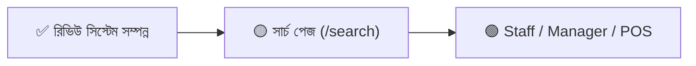

# VibeLock — প্রজেক্ট রোডম্যাপ ও প্রডাকশন রেডিনেস অডিট

> **অডিট তারিখ:** ১ নভেম্বর ২০২৬ | **ব্রাঞ্চ:** `dashboard` | **স্ট্যাটাস:** Review System & Critical Fixes Completed

---

## 📊 বর্তমান অবস্থা (Current Health)

| মেট্রিক               | সংখ্যা                             |
| --------------------- | ---------------------------------- |
| মোট কম্পোনেন্ট ফাইল   | ১৯৫+                               |
| লিব/সার্ভিস মডিউল     | ১১৭+                               |
| টেস্ট ফাইল            | ৪০ (৩২৩+ টেস্ট কেস)                |
| ডাটাবেজ মডেল (Prisma) | ৩১                                 |
| API রাউট              | ১১                                 |
| অ্যাডমিন সেকশন        | ১৬ (Reviews সহ)                    |
| পেমেন্ট গেটওয়ে       | ৩ (SSLCommerz, bKash, Nagad) + COD |
| শিপিং প্রোভাইডার      | Steadfast (+ Mock)                 |
| HACK/TODO কমেন্ট      | মাত্র ১টি                          |

> [!TIP]
> কোডবেজ অত্যন্ত পরিষ্কার ও সুসংগঠিত। পেমেন্ট, শিপিং, ইনভেন্টরি, অর্ডার ম্যানেজমেন্ট এবং প্রোডাক্ট রিভিউ সম্পূর্ণভাবে কার্যকর।

---

## 🔴 ক্রিটিকাল — লঞ্চের আগে যা বাকি ছিল [✅ সম্পূর্ণ সমাধান করা হয়েছে]

### ১. আইনি/পলিসি পেজ তৈরি করা ✅ (সম্পন্ন)

- ✅ `/terms` — Terms & Conditions (সাপোর্টেড ও স্টোরফ্রন্ট ডার্ক থিম কমপ্লায়েন্ট)
- ✅ `/privacy` ও `/privacy-policy` — Privacy Policy (গ্রাহক ডেটা, কুকিজ ও পেমেন্ট নিরাপত্তা)
- ✅ `/return-policy` — Return & Exchange Policy (৭ দিনের এক্সচেঞ্জ নীতিমালা ও শর্তাবলী)
- ✅ `/shipping-policy` — Shipping Policy (ঢাকার ভেতরে ও বাইরে Steadfast ডেলিভারি রেট ও সময়)
- ✅ `/faq` — Frequently Asked Questions (অর্ডার, সাইজিং, ডেলিভারি ও কেয়ার গাইড সংক্রান্ত FAQ)
- ✅ `footer.tsx` এবং `sitemap.ts`-এ সফলভাবে সংযুক্ত

---

### ২. অর্ডার কনফার্মেশন ইমেইল ✅ (সম্পন্ন)

- ✅ `src/lib/email/order-emails.ts` বাস্তবায়িত (Resend API ভিত্তিক)
- ✅ ক্যাশ অন ডেলিভারি (COD) চেকআউট সম্পন্ন হলে স্বয়ংক্রিয় নন-ব্লকিং ব্যাকগ্রাউন্ড ইমেইল
- ✅ অনলাইন পেমেন্ট (bKash/Nagad/SSLCommerz) সফল ভেরিফিকেশনে স্বয়ংক্রিয় কনফার্মেশন ইমেইল
- ✅ আইটেমাইজড টেবিল, ডেলিভারি ঠিকানা, ডিসকাউন্ট ও মোট বিল ব্রেকডাউন

---

### ৩. Middleware / Proxy Route Guard ✅ (সম্পন্ন)

- ✅ Next.js 16-এর জন্য `src/proxy.ts`-এ সেন্ট্রালাইজড Auth Guard (`/admin/:path*`, `/manager/:path*`, `/staff/:path*`, `/account/:path*`) ও CSP সুরক্ষা নিশ্চিত করা হয়েছে।

---

### ৪. Global Error Page ও Safe Testing ✅ (সম্পন্ন)

- ✅ `src/app/global-error.tsx` তৈরি করা হয়েছে (App Router স্পেসিফিকেশন অনুযায়ী html/body ট্যাগ সহ)
- ✅ `package.json`-এ সেফ ইউনিট টেস্ট স্ক্রিপ্ট কনফিগার করা হয়েছে।
- ✅ টেস্ট ভেরিফিকেশন: ৪০টি টেস্ট ফাইল ও ৩২৩টি ইউনিট টেস্ট শতভাগ পাস, জিরো টাইপ এরর, জিরো লিন্ট সমস্যা।

---

## 🟡 উচ্চ অগ্রাধিকার — অগ্রগতি ও পরবর্তী ধাপ

### ৫. প্রোডাক্ট রিভিউ/রেটিং সিস্টেম ✅ (সম্পন্ন)

- ✅ স্টোরফ্রন্ট প্রোডাক্ট ডিটেইলস পেজে (`/products/[slug]`) রেটিং ও রিভিউ সেকশন যুক্ত করা হয়েছে।
- ✅ **Verified Buyers Only গ্যারান্টি:** শুধুমাত্র যে ক্রেতা পণ্যটি কিনেছেন এবং সফল ডেলিভারি (`DELIVERED`) পেয়েছেন, তিনিই রিভিউ লিখতে বা এডিট করতে পারবেন।
- ✅ রেটিং সামারি, ৫-স্টার ডিস্ট্রিবিউশন বার, ইন্টারেক্টিভ স্টার ইনপুট ও গুগল এসইও AggregateRating স্কিমা।
- ✅ অ্যাডমিন প্যানেলে রিভিউ মডারেশন (`/admin/reviews`) এবং সাইডবার নেভিগেশনে Reviews যুক্ত করা হয়েছে।

---

### ৬. ডেডিকেটেড সার্চ পেজ (`/search`)

`/api/search` API রাউট আছে কিন্তু কোনো ডেডিকেটেড সার্চ রেজাল্ট পেজ নেই।

**সময়:** ~৩-৪ ঘণ্টা

---

### ৭. Manager ও Staff ড্যাশবোর্ড

বর্তমানে দুটোই **সম্পূর্ণ খালি** (শুধুমাত্র placeholder টেক্সট)।

- **Staff:** অর্ডার প্রসেসিং, পিক-প্যাক চেকলিস্ট, ইনভেন্টরি ভিউ
- **Manager:** সেলস রিপোর্ট, স্টাফ ম্যানেজমেন্ট, ডিসকাউন্ট অনুমোদন

**সময়:** ~১-২ দিন (প্রতিটি)

---

### ৮. সিকিউরিটি — CSP Header

বর্তমানে `next.config.ts`-এ ৫টি সিকিউরিটি হেডার আছে এবং `src/proxy.ts`-এ ডায়নামিক ননস (nonce) ভিত্তিক CSP কনফিগার করা হয়েছে।

---

## 🎯 প্রস্তাবিত পরবর্তী কাজের ক্রম

