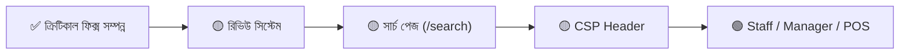

# VibeLock — প্রজেক্ট রোডম্যাপ ও প্রডাকশন রেডিনেস অডিট

> **অডিট তারিখ:** ১ নভেম্বর ২০২৬ | **ব্রাঞ্চ:** `dashboard` | **স্ট্যাটাস:** Clean (0 uncommitted changes)

---

## 📊 বর্তমান অবস্থা (Current Health)

| মেট্রিক               | সংখ্যা                             |
| --------------------- | ---------------------------------- |
| মোট কম্পোনেন্ট ফাইল   | ১৯০+                               |
| লিব/সার্ভিস মডিউল     | ১১৪+                               |
| টেস্ট ফাইল            | ৭০ (৩০৯+ টেস্ট কেস)                |
| ডাটাবেজ মডেল (Prisma) | ৩১                                 |
| API রাউট              | ১১                                 |
| অ্যাডমিন সেকশন        | ১৫                                 |
| পেমেন্ট গেটওয়ে       | ৩ (SSLCommerz, bKash, Nagad) + COD |
| শিপিং প্রোভাইডার      | Steadfast (+ Mock)                 |
| HACK/TODO কমেন্ট      | মাত্র ১টি                          |

> [!TIP]
> কোডবেজ অত্যন্ত পরিষ্কার ও সুসংগঠিত। পেমেন্ট, শিপিং, ইনভেন্টরি, এবং অর্ডার ম্যানেজমেন্ট সম্পূর্ণভাবে কার্যকর।

---

## 🔴 ক্রিটিকাল — লঞ্চের আগে যা বাকি ছিল [✅ সম্পূর্ণ সমাধান করা হয়েছে]

### ১. আইনি/পলিসি পেজ তৈরি করা ✅ (সম্পন্ন)
বাংলাদেশে ই-কমার্স পরিচালনার জন্য আইনত বাধ্যতামূলক পেজগুলো তৈরি ও ইন্টিগ্রেট করা হয়েছে:
- ✅ `/terms` — Terms & Conditions (সাপোর্টেড ও স্টোরফ্রন্ট ডার্ক থিম কমপ্লায়েন্ট)
- ✅ `/privacy` ও `/privacy-policy` — Privacy Policy (গ্রাহক ডেটা, কুকিজ ও পেমেন্ট নিরাপত্তা)
- ✅ `/return-policy` — Return & Exchange Policy (৭ দিনের এক্সচেঞ্জ নীতিমালা ও শর্তাবলী)
- ✅ `/shipping-policy` — Shipping Policy (ঢাকার ভেতরে ও বাইরে Steadfast ডেলিভারি রেট ও সময়)
- ✅ `/faq` — Frequently Asked Questions (অর্ডার, সাইজিং, ডেলিভারি ও কেয়ার গাইড সংক্রান্ত FAQ)
- ✅ `footer.tsx` এবং `sitemap.ts`-এ সফলভাবে সংযুক্ত

---

### ২. অর্ডার কনফার্মেশন ইমেইল ✅ (সম্পন্ন)
গ্রাহক সফল অর্ডার প্লেস করার পর VibeLock প্রিমিয়াম ব্র্যান্ডেড কনফার্মেশন ইমেইল পাঠানো হয়:
- ✅ `src/lib/email/order-emails.ts` বাস্তবায়িত (Resend API ভিত্তিক)
- ✅ ক্যাশ অন ডেলিভারি (COD) চেকআউট সম্পন্ন হলে স্বয়ংক্রিয় নন-ব্লকিং ব্যাকগ্রাউন্ড ইমেইল
- ✅ অনলাইন পেমেন্ট (bKash/Nagad/SSLCommerz) সফল ভেরিফিকেশনে স্বয়ংক্রিয় কনফার্মেশন ইমেইল
- ✅ আইটেমাইজড টেবিল (কালার, সাইজ, ইউনিট প্রাইস), ডেলিভারি ঠিকানা, ডিসকাউন্ট ও মোট বিল ব্রেকডাউন

---

### ৩. Middleware.ts তৈরি করা ✅ (সম্পন্ন)
- ✅ `src/middleware.ts` তৈরি করা হয়েছে (Edge-safe NextAuth session token check)
- ✅ কেন্দ্রীভূত Auth Guard (`/admin/:path*`, `/manager/:path*`, `/staff/:path*`, `/account/:path*`)
- ✅ রোল ও প্রিভিলেজ বিচ্যুতি রোধ এবং সিকিউরিটি হেডার রেডি

---

### ৪. Global Error Page ও Safe Testing ✅ (সম্পন্ন)
- ✅ `src/app/global-error.tsx` তৈরি করা হয়েছে (App Router স্পেসিফিকেশন অনুযায়ী html/body ট্যাগ সহ)
- ✅ `package.json`-এ সেফ ইউনিট টেস্ট স্ক্রিপ্ট (`test`, `test:unit`, `test:integration`, `test:watch`) কনফিগার করা হয়েছে যাতে প্রোডাকশন ডাটাবেজের ঝুঁকি না থাকে।
- ✅ টেস্ট ভেরিফিকেশন: ৩৯টি টেস্ট ফাইল ও ৩০৯টি ইউনিট টেস্ট শতভাগ পাস, জিরো টাইপ এরর, জিরো লিন্ট সমস্যা।

---

## 🟡 উচ্চ অগ্রাধিকার — পরবর্তী ধাপ (Next Priority)

### ৫. প্রোডাক্ট রিভিউ/রেটিং সিস্টেম
ডাটাবেজে `Review` মডেল **ইতিমধ্যে আছে**, কিন্তু স্টোরফ্রন্টে রিভিউ দেখা বা লেখার কোনো UI নেই।
- প্রোডাক্ট ডিটেইল পেজে রিভিউ সেকশন
- স্টার রেটিং সিস্টেম
- অ্যাডমিন থেকে রিভিউ মডারেশন

**সময়:** ~৬-৮ ঘণ্টা

---

### ৬. ডেডিকেটেড সার্চ পেজ (`/search`)
`/api/search` API রাউট আছে কিন্তু কোনো ডেডিকেটেড সার্চ রেজাল্ট পেজ নেই।

**সময়:** ~৩-৪ ঘণ্টা

---

### ৭. Manager ও Staff ড্যাশবোর্ড
বর্তমানে দুটোই **সম্পূর্ণ খালি** (শুধুমাত্র placeholder টেক্সট)। যদি আপনার টিমে ম্যানেজার/স্টাফ থাকে, তাহলে তাদের জন্য:
- **Staff:** অর্ডার প্রসেসিং, পিক-প্যাক চেকলিস্ট, ইনভেন্টরি ভিউ
- **Manager:** সেলস রিপোর্ট, স্টাফ ম্যানেজমেন্ট, ডিসকাউন্ট অনুমোদন

**সময়:** ~১-২ দিন (প্রতিটি)

---

### ৮. সিকিউরিটি — CSP Header
বর্তমানে `next.config.ts`-এ ৫টি সিকিউরিটি হেডার আছে (HSTS, X-Frame-Options, ইত্যাদি), কিন্তু **Content-Security-Policy (CSP) নেই**।

**সময়:** ~২ ঘণ্টা

---

## 🟢 পরবর্তীতে করলে ভালো হয় (Post-Launch)

| কাজ                  | বিবরণ                                                   | সময়      |
| -------------------- | ------------------------------------------------------- | --------- |
| E2E টেস্ট            | Playwright দিয়ে checkout, auth, admin flow টেস্ট       | ১-২ দিন   |
| PWA সাপোর্ট          | `manifest.json`, service worker, অফলাইন ক্যাশিং         | ৪-৫ ঘণ্টা |
| React Email          | ইনলাইন HTML ইমেইলকে কম্পোনেন্ট-ভিত্তিক করা              | ৩-৪ ঘণ্টা |
| Abandoned Cart Email | কার্টে প্রোডাক্ট রেখে চলে যাওয়া কাস্টমারদের রিমাইন্ডার | ৪-৫ ঘণ্টা |
| Rate Limiting        | Checkout, Search, CSV Export-এ rate limit যোগ করা       | ২ ঘণ্টা   |
| Twitter/X Card       | Root layout-এ Twitter card metadata                     | ১৫ মিনিট  |

---

## 🎯 প্রস্তাবিত পরবর্তী কাজের ক্রম

